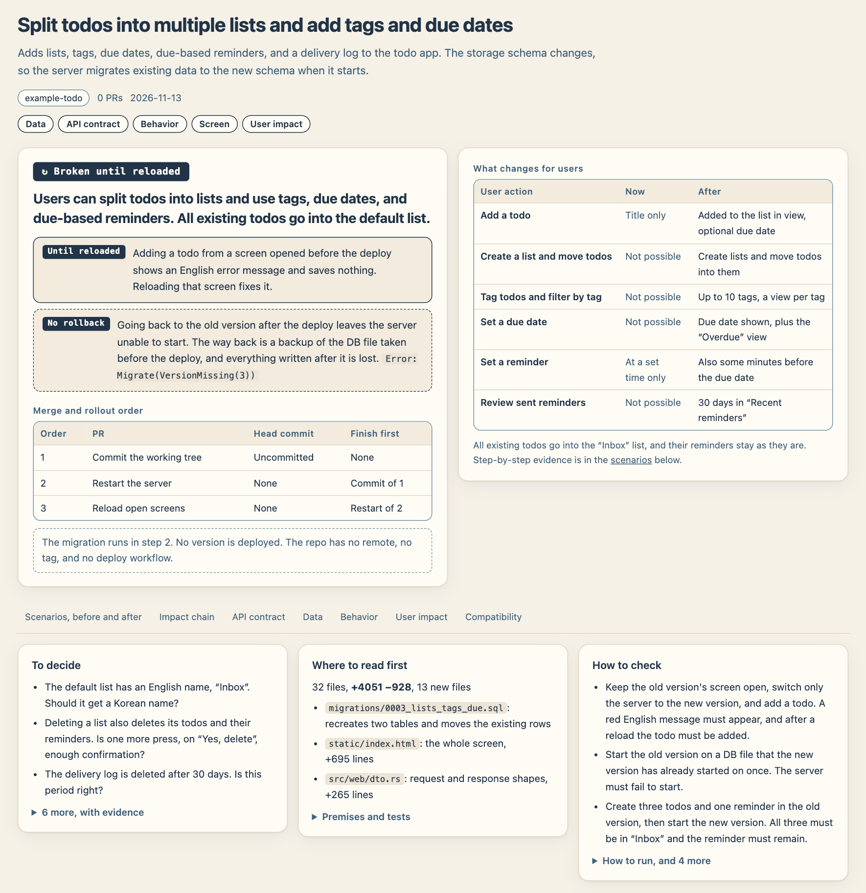
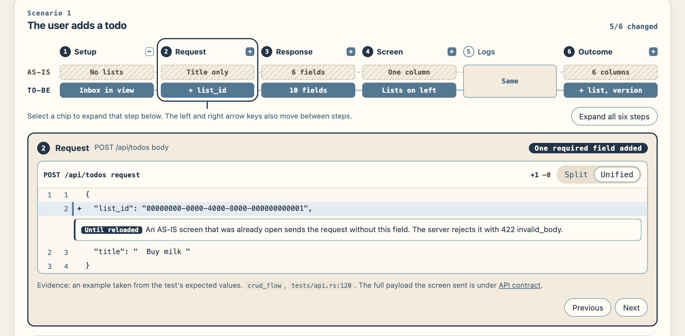
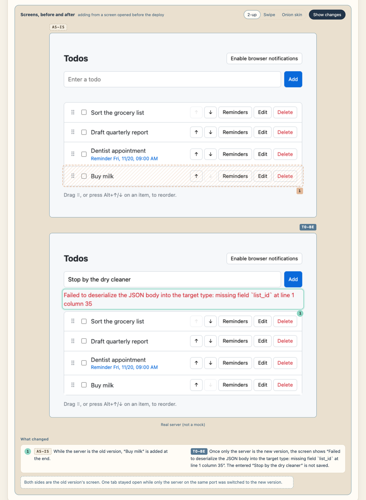
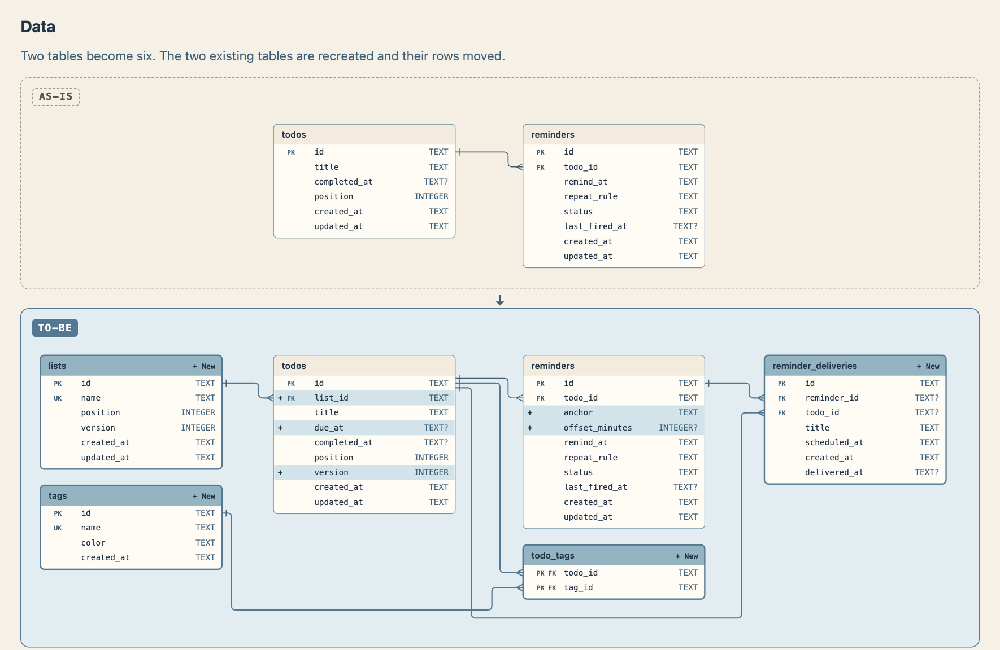
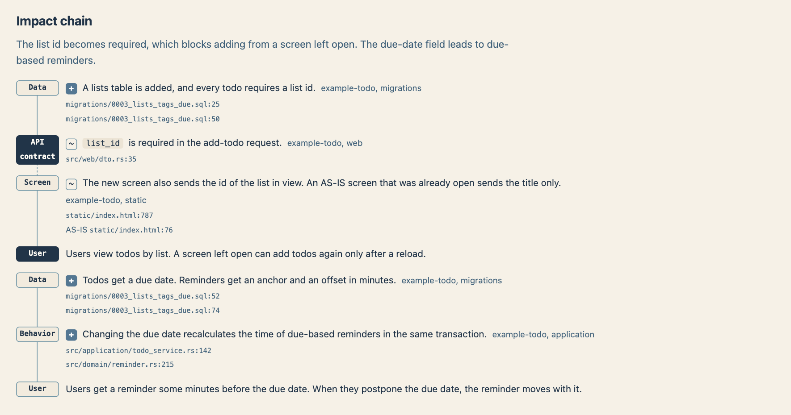
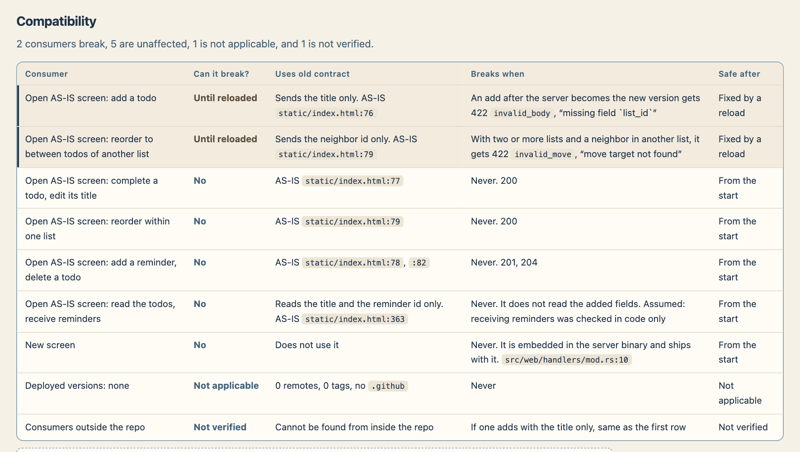

# asis-tobe

**English** | [한국어](docs/readme_ko.md)

[](https://skills.sh/chordpli/asis-tobe)

A Claude Code skill that shows, on **one HTML page**, what a single change does to the data, the API, the server behavior, the screen, and the user. Give it a PR, a branch, an uncommitted working tree, a bundle of PRs across several repos, or an issue. It puts AS-IS and TO-BE side by side, links the layers by cause and effect, and writes down the rollout order.

The page is for reviewers, QA, and planners to read before they open the code. The first screen alone should tell them whether the change is safe to merge, what breaks, and whether it can be rolled back.



Full example documents: [English](examples/example-todo.en.html), [한국어](examples/example-todo.ko.html)

## Quick start

```bash
npx skills add chordpli/asis-tobe -g -a claude-code
```

As a Claude Code plugin (2.1.275 or later):

```text
/plugin install asis-tobe --marketplace chordpli/asis-tobe
```

Or clone it yourself:

```bash
git clone https://github.com/chordpli/asis-tobe.git ~/.claude/skills/asis-tobe
```

`-g` installs it at user level, for every project. Leave it out to install into the current project only. To update, run `npx skills update asis-tobe -g`, or `git pull` in a cloned folder.

Then ask Claude Code in plain words.

```text
Write an AS-IS / TO-BE comparison for this PR, in English
```

The same skill answers requests like these.

```text
Show me what this branch changes on the screen
If I change the server like this, what happens to the app?
Nothing is committed yet. Compare before and after from the working tree
Compare before and after for #412 together with #88 in the web repo
Also make a before/after section for the PR body
```

You can also call it directly with `/asis-tobe`. The document is written in Korean unless you ask for another language.

## What you get

### The first screen is enough to decide

- **One badge.** The worst case among “Compatible”, “Broken until reloaded”, “Breaks if rollout order is wrong”, and “breaking change”.
- **A one-sentence verdict.** In the user's words, with no field names or status codes.
- **Warnings and rollback.** Who runs into what, and whether the previous version can come back after shipping. Rollback is not guessed: the skill opens the migrated data with the previous binary and reports what happened.
- **Rollout order.** One line per step, including the steps a breakage depends on (a server restart, a page reload).
- **What changes for users.** One row per user action, now and after.
- **Three question cards.** “To decide”, “Where to read first”, and “How to check”. They are split by what the reader asks, not by the reader's job.

### Each scenario is followed through six steps

One user action is split into Setup, Request, Response, Screen, Logs, and Outcome, each shown before and after. Requests and responses are line diffs of real payloads, and the line that causes a breakage carries a note.



### Screens are captured from running servers

The skill starts both versions, loads the same data into each, and captures the screen. Changed spots get numbered boxes, and each number gets one card describing both sides. The reader can switch between 2-up, swipe, and onion skin.

When the badge is not “Compatible”, the broken state is captured too. Below is the error a user really gets when adding a todo from a page that was open before the deploy.



### Data is compared as entity diagrams

Tables and fields are drawn before and after, with new tables and fields marked. The model code on both sides and the full field table are folded underneath.



### The layers are linked by cause and effect

A change in the data leads to a change in the API, which reaches a screen and then the user. Each link carries its evidence as `file:line`.



### Compatibility is written per consumer

For each request an already-running old page or old app sends to the new server, one row says whether it breaks, why, and when it becomes safe. What could not be checked stays “Not verified”.



## When it fits and when it does not

### Fits

- A PR changes both server and screen, and reviewers and planners need something to read before it goes up
- A schema or API payload changes and you are worried about clients that are already deployed
- PRs in several repos must be merged and deployed in some order, and that order needs writing down
- A change carries a migration and you want to know beforehand whether it can be rolled back

### Does not fit

- An audit that hunts for every risk. The skill covers the consumers it finds and does not search beyond them.
- A walkthrough that explains the code from start to finish
- A single structure diagram. That is a diagram skill's job.
- Changing code. The skill reads and runs code; it does not edit it.

## How it works

The skill goes through ten steps. The full rules are in [SKILL.md](SKILL.md).

1. Fix the scope: the base commit and the head commit.
2. Assign the changed files to layers. An unchanged layer keeps one line with its evidence.
3. Decide whether the screen really changes. Code can change while the branch stays unreachable with current data; then the screen is the same.
4. Collect real AS-IS and TO-BE artifacts for each layer (real payloads, schema, screens, deployed versions) and fill the six steps of each scenario.
5. Link the layers by cause and effect.
6. Judge compatibility and set the merge and rollout order. Rollback is actually run.
7. Mark the changed spots on the captures and pass the render check.
8. Edit the text per language and pass the text check.
9. Produce the document as one file. Captures go inside the HTML.
10. Before reporting, measure the facts in the document again from the source.

The last step is the point of the skill. Commit hashes, line counts, status codes, error strings, test pass counts, and claims such as “none found” are not trusted as written: the commands are run again. Where no real artifact could be obtained, nothing plausible is made up; the document says “Not available” or “Not verified”.

A document is finished only when it passes two checks.

- `scripts/text_lint.py`: long sentences, filler modifiers, mixed terms for one concept, translationese, and identifiers in the verdict.
- `scripts/render_check.mjs`: opens the document in headless Chrome and checks whether a box leaves its image, whether a narrow screen scrolls sideways, and whether a script throws. It also saves captures in both color themes and at 420px width.

## Requirements

- Claude Code
- Python 3 with `numpy` (used by `diff_boxes.py`, which finds the changed spots between two captures)
- Node.js with `puppeteer-core`, and Chrome or Chromium. Set `CHROME_PATH` if it is not in a default location.
- The `gh` CLI when working with GitHub PRs

To capture screens, the target project must build and run locally. For a platform that cannot be run, the document says “Not available” and shows test assertions and rendering code instead.

## Fitting it to a project

The skill itself holds no project's commands. Whatever differs per project goes in an adapter note, which the skill reads. It looks in this order and uses the first one found.

1. `<repo>/.claude/asis-tobe.md`
2. `.claude/asis-tobe.md` in the folder that holds several repos
3. A file in `~/.claude/asis-tobe-adapters/*.md` whose first line `repos:` names this repo

A note holds five things: the command that captures screens, where the API spec and generated code live, how to find the deployed version, where `puppeteer-core` is installed, and where PR images and documents go. Without a note the skill finds these in the repo and lists the commands it found in its report, so you can move them into a note. Format and examples are in [references/adapters.md](references/adapters.md).

## Output

- One Korean document by default. An English edition is rewritten as English technical writing, not translated, and saved as its own file.
- It is saved where the project's documentation rules or the adapter note say; otherwise `~/Downloads/asis-tobe-<slug>.html`.
- One file, with no external CDN and no image folder. It still opens after being sent through a messenger.
- On request, a markdown edition for the PR body.
- Two color themes, Dusk and Bloom. Readable on a narrow screen and in print.

## Repository layout

```text
SKILL.md                  The skill: principles and the ten steps
references/
  template.html           Document template (styles and scripts included)
  document.md             Rules for the summary, question cards, and layer sections
  scenario-rail.md        Rules for the six scenario steps
  screens.md              Rules for captures and boxes
  layers.md               Checklist per layer
  domains.md              Scenario skeleton and per-domain mapping
  terms.md                Sentence and terminology rules
  adapters.md             Project adapter notes
scripts/
  code_diff.py            Line diff of code and payloads
  erd.py                  Entity relationship diagrams
  diff_boxes.py           Finds changed spots between two captures
  inline_images.py        Puts captures inside the HTML
  text_lint.py            Text check
  render_check.mjs        Render check
docs/
  readme_ko.md            Korean README
  images/                 README captures (en, ko)
examples/
  example-todo.en.html    Full example document (English)
  example-todo.ko.html    Full example document (Korean)
```

## Good to know

- One run takes a little over 20 minutes. It builds both versions, runs them, measures, and measures again at the end.
- The document is long. Folded, it can pass 10,000px at 1280px width. It is built so that you decide on the first screen and open only what you need.
- Consumers outside the repo cannot be seen. They are written as “Not verified”.

## License

[MIT](LICENSE)
