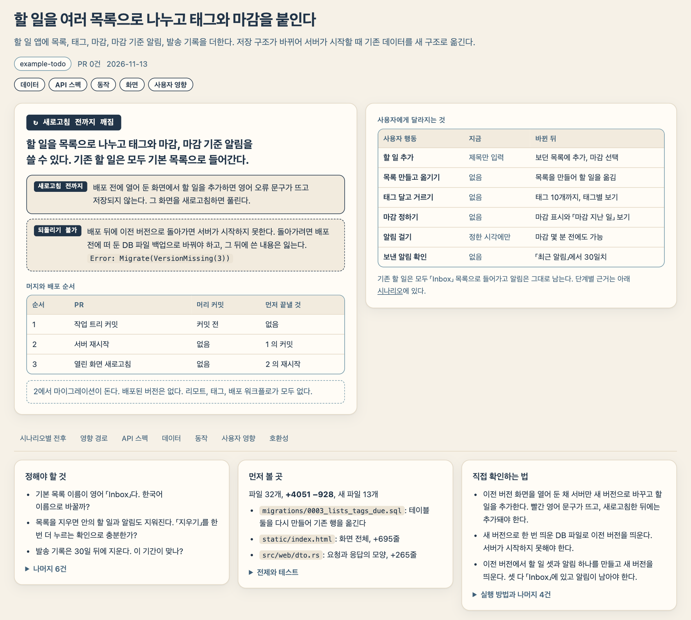
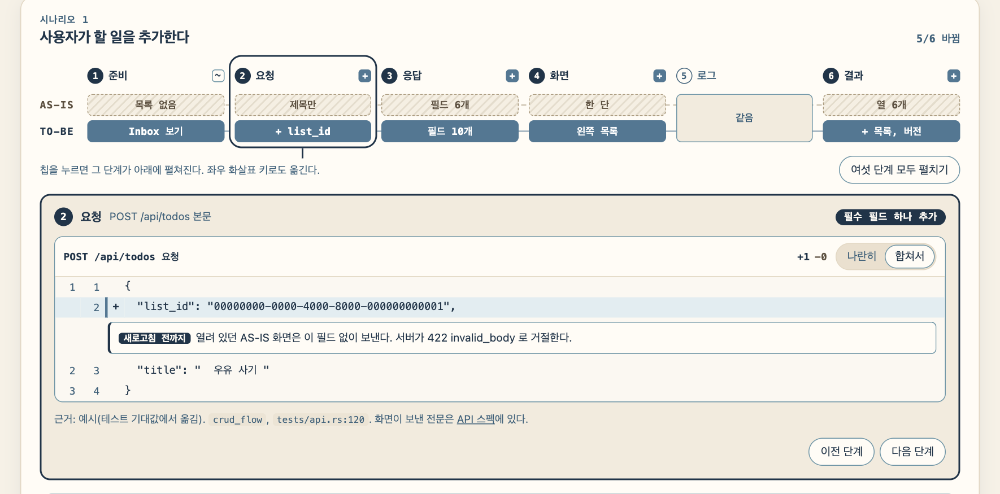
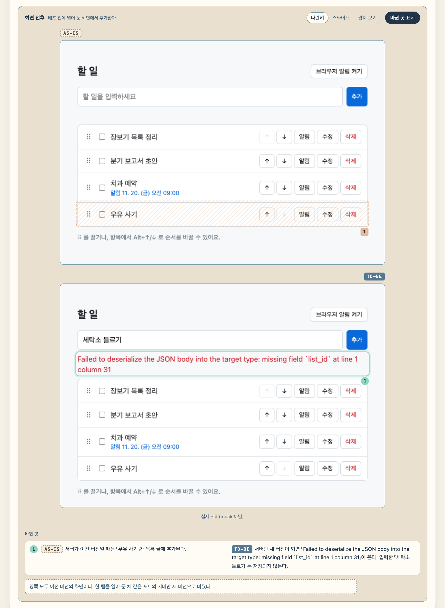
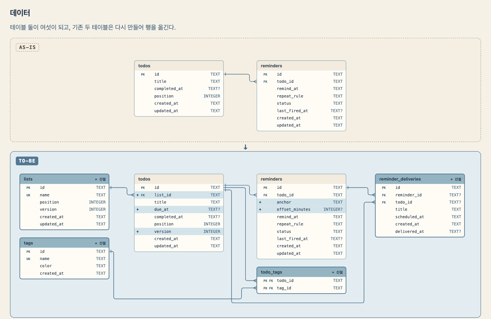
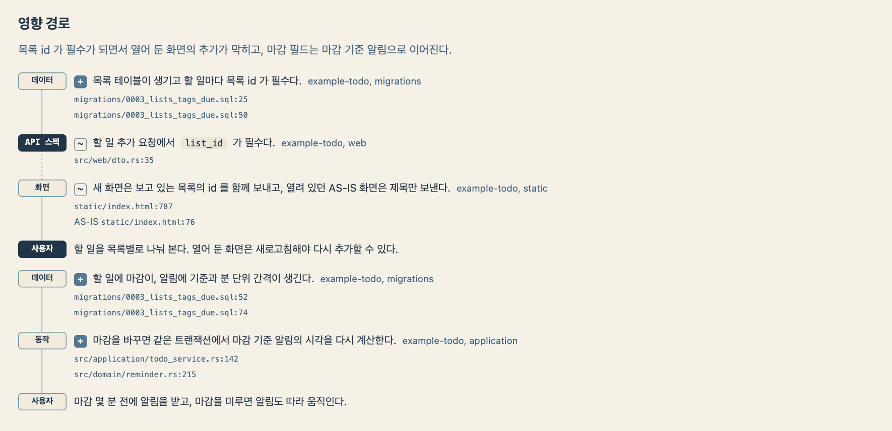
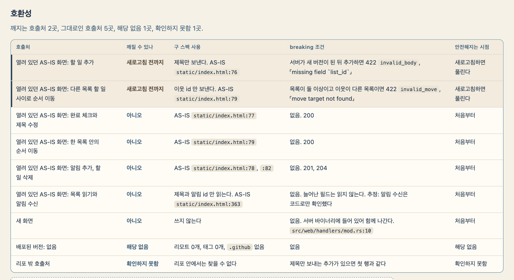

# asis-tobe

[English](../README.md) | **한국어**

[](https://skills.sh/chordpli/asis-tobe)

변경 하나가 데이터, API, 서버 동작, 화면, 사용자에게 각각 무엇을 바꾸는지 **한 장의 HTML** 로 보여 주는 Claude Code 스킬이에요. PR, 브랜치, 커밋 전 작업 트리, 여러 리포에 걸친 PR 묶음, 이슈 중 무엇을 줘도 AS-IS 와 TO-BE 를 나란히 놓고, 레이어 사이의 인과와 배포 순서까지 적어요.

리뷰어, QA, 기획자가 코드를 열기 전에 읽는 문서를 만드는 것이 목적이에요. 첫 화면만 읽어도 머지해도 되는지, 무엇이 깨지는지, 되돌릴 수 있는지 판단할 수 있어야 해요.



전체 문서 예시: [한국어](../examples/example-todo.ko.html), [English](../examples/example-todo.en.html)

## 30초 시작

```bash
npx skills add chordpli/asis-tobe -g -a claude-code
```

Claude Code 플러그인으로도 설치할 수 있어요(2.1.275 이상).

```text
/plugin install asis-tobe --marketplace chordpli/asis-tobe
```

직접 clone 해도 돼요.

```bash
git clone https://github.com/chordpli/asis-tobe.git ~/.claude/skills/asis-tobe
```

`-g` 는 사용자 단위 설치라 모든 프로젝트에서 쓸 수 있어요. 빼면 지금 프로젝트에만 설치돼요. 갱신은 `npx skills update asis-tobe -g` 이고, clone 한 폴더라면 `git pull` 이에요.

설치한 뒤 Claude Code 에서 평소 말로 부탁하면 돼요.

```text
이 PR AS-IS TO-BE 정리해줘
```

이런 요청에도 같은 스킬이 움직여요.

```text
이 브랜치가 화면에 뭘 바꾸는지 보여줘
서버를 이렇게 바꾸면 앱에 어떤 영향이 있어?
커밋 전인데, 지금 작업 트리 기준으로 변경 전후 비교 문서 만들어줘
#412 랑 web 리포 #88 을 묶어서 전후 비교해줘
PR 본문에 넣을 전후 비교도 같이 만들어줘
```

`/asis-tobe` 로 직접 불러도 돼요.

## 무엇이 나오나

### 첫 화면에서 판단이 끝나요

- **배지 하나.** 「호환」, 「새로고침 전까지 깨짐」, 「배포 순서를 어기면 깨짐」, 「breaking change」 가운데 가장 나쁜 경우 하나를 골라요.
- **결론 한 문장.** 필드 이름이나 상태 코드 없이 사용자의 말로 적어요.
- **경고와 되돌리기.** 누가 무엇을 겪는지, 배포 뒤 이전 버전으로 돌아갈 수 있는지를 적어요. 되돌리기는 추측하지 않고, 옮겨진 데이터를 이전 바이너리로 실제로 열어 보고 판정해요.
- **배포 순서.** 깨짐이 걸린 단계(서버 재시작, 화면 새로고침)까지 한 줄씩 적어요.
- **사용자에게 달라지는 것.** 사용자 행동마다 지금과 바뀐 뒤를 한 줄로 비교해요.
- **질문 카드 셋.** 「정해야 할 것」, 「먼저 볼 곳」, 「직접 확인하는 법」이에요. 읽는 사람의 직무가 아니라 읽는 사람이 묻는 것으로 나눴어요.

### 시나리오마다 여섯 단계로 따라가요

사용자 행동 하나를 준비, 요청, 응답, 화면, 로그, 결과의 여섯 칸으로 나누고 칸마다 전후를 보여 줘요. 요청과 응답은 실제 payload 의 줄 단위 diff 이고, 깨짐을 일으키는 줄에는 메모가 붙어요.



### 화면은 실제로 띄워서 찍어요

두 버전의 서버를 각각 띄우고 같은 데이터를 넣은 뒤 캡처해요. 바뀐 자리에는 번호가 붙은 상자를 그리고, 번호마다 전후 설명을 한 장씩 달아요. 나란히, 스와이프, 겹쳐 보기로 바꿔 볼 수 있어요.

배지가 「호환」이 아니면 깨진 상태도 찍어요. 아래는 배포 전에 열어 둔 화면에서 할 일을 추가했을 때 실제로 뜨는 오류예요.



### 데이터는 관계도로 비교해요

테이블과 필드의 전후를 관계도로 그리고, 새로 생긴 테이블과 필드를 표시해요. 모델 코드의 전후와 필드 전체 표는 그 아래에 접혀 있어요.



### 레이어 사이의 인과를 한 줄로 이어요

데이터의 변화가 어떤 API 변화를 낳고, 그것이 어느 화면을 거쳐 사용자에게 무엇으로 닿는지를 근거 줄(`file:line`)과 함께 이어요.



### 호환성은 호출처 단위로 적어요

이미 돌고 있는 옛 화면과 옛 앱이 새 서버를 만났을 때 요청마다 어떻게 되는지를 한 행씩 적어요. 확인하지 못한 곳은 「확인하지 못함」으로 남겨요.



## 맞는 경우와 맞지 않는 경우

### 맞는 경우

- 서버와 화면을 함께 바꾸는 PR 을 올리기 전에 리뷰어와 기획자에게 보여 줄 문서가 필요할 때
- 스키마나 API payload 가 바뀌어서 이미 배포된 클라이언트가 걱정될 때
- 여러 리포의 PR 을 어떤 순서로 머지하고 배포해야 하는지 정리해야 할 때
- 마이그레이션이 있는 변경을 되돌릴 수 있는지 미리 알고 싶을 때

### 맞지 않는 경우

- 위험 요소를 빠짐없이 찾는 감사. 이 스킬은 찾은 호출처만 다루고 그 밖은 뒤지지 않아요.
- 코드를 처음부터 끝까지 설명하는 워크스루
- 구조도 한 장. 그건 다이어그램 스킬의 일이에요.
- 코드 수정. 이 스킬은 읽고 실행해 볼 뿐 코드를 고치지 않아요.

## 동작 방식

스킬은 열 단계를 차례로 밟아요. 전체 규칙은 [SKILL.md](../SKILL.md) 에 있어요.

1. 대상을 정하고 기준 커밋과 머리 커밋을 고정해요.
2. 바뀐 파일을 레이어에 나눠 담아요. 바뀌지 않은 레이어는 근거와 함께 한 줄로 남겨요.
3. 화면이 실제로 바뀌는지부터 판단해요. 코드가 바뀌어도 지금 데이터로 닿지 않는 분기면 화면은 그대로예요.
4. 레이어마다 AS-IS 와 TO-BE 의 실물을 모으고(실제 payload, 스키마, 화면, 배포된 버전), 시나리오별 여섯 단계를 채워요.
5. 레이어를 인과로 이어요.
6. 호환성을 판정하고 머지와 배포 순서를 매겨요. 되돌리기는 실제로 돌려 봐요.
7. 캡처에 바뀐 자리를 표시하고 렌더 점검을 통과시켜요.
8. 언어별로 글을 다듬고 문장 점검을 통과시켜요.
9. 문서를 한 파일로 만들어요. 캡처는 HTML 안에 들어가요.
10. 보고하기 전에 문서에 적은 사실을 원본에서 다시 재요.

마지막 단계가 이 스킬의 핵심이에요. 커밋 해시, 줄 수, 상태 코드, 오류 문구, 테스트 통과 수, 「0건」 같은 주장을 적은 값을 믿지 않고 명령을 다시 돌려 확인해요. 실물을 구하지 못한 곳은 그럴듯하게 지어내지 않고 「실물 없음」이나 「확인하지 못함」으로 적어요.

문서는 점검 두 개를 통과해야 끝나요.

- `scripts/text_lint.py`: 긴 문장, 꾸밈말, 한 개념에 섞인 용어, 번역투, 결론에 섞인 식별자를 잡아요.
- `scripts/render_check.mjs`: 헤드리스 Chrome 으로 문서를 띄워 상자가 이미지 밖으로 나갔는지, 좁은 화면에서 가로 스크롤이 생기는지, 스크립트 오류가 있는지 봐요. 두 색 테마와 420px 너비의 캡처도 남겨요.

## 요구 사항

- Claude Code
- Python 3 과 `numpy` (캡처 두 장에서 바뀐 자리를 찾는 `diff_boxes.py` 가 써요)
- Node.js 와 `puppeteer-core`, 그리고 Chrome 이나 Chromium. 기본 위치가 아니면 `CHROME_PATH` 로 알려 줘요.
- GitHub PR 을 다룰 때는 `gh` CLI

화면을 찍으려면 대상 프로젝트를 로컬에서 빌드하고 띄울 수 있어야 해요. 띄울 수 없는 플랫폼은 「실물 없음」으로 적고 테스트 단언과 렌더링 코드로 대신 보여 줘요.

## 프로젝트에 맞추기

스킬 자체에는 어떤 프로젝트의 명령도 들어 있지 않아요. 프로젝트마다 다른 것은 어댑터 노트에 적어 두면 스킬이 읽어요. 아래 순서로 찾고 처음 찾은 것을 써요.

1. `<리포>/.claude/asis-tobe.md`
2. 여러 리포를 담은 폴더의 `.claude/asis-tobe.md`
3. `~/.claude/asis-tobe-adapters/*.md` 중 첫 줄 `repos:` 에 이 리포가 적힌 것

노트에는 다섯 가지를 적어요. 화면을 찍는 명령, API 스펙과 생성 코드의 위치, 배포된 버전을 찾는 법, `puppeteer-core` 가 설치된 곳, PR 이미지와 문서를 둘 곳이에요. 노트가 없으면 스킬이 리포에서 직접 찾고, 찾은 명령을 보고에 적어 줘서 노트로 옮길 수 있어요. 형식과 예시는 [references/adapters.md](../references/adapters.md) 에 있어요.

## 결과물

- 기본은 한국어 문서 한 파일이에요. 영어를 요청하면 번역이 아니라 영어 기술 문서로 다시 써서 따로 만들어요.
- 저장 위치는 프로젝트의 문서 규칙이나 어댑터 노트를 따르고, 없으면 `~/Downloads/asis-tobe-<slug>.html` 이에요.
- 외부 CDN 이나 이미지 폴더 없이 파일 하나로 열려요. 메신저로 보내도 그대로 보여요.
- 요청하면 PR 본문에 넣을 마크다운판도 만들어요.
- Dusk 와 Bloom 두 색 테마가 있고, 좁은 화면과 인쇄에서도 읽을 수 있어요.

## 저장소 구조

```text
SKILL.md                  스킬 본문: 원칙과 열 단계
references/
  template.html           문서 템플릿 (스타일과 스크립트 포함)
  document.md             요약, 질문 카드, 레이어 섹션을 채우는 규칙
  scenario-rail.md        시나리오 여섯 단계 규칙
  screens.md              화면 캡처와 상자 표시 규칙
  layers.md               레이어별 점검 항목
  domains.md              시나리오 뼈대와 도메인별 대응표
  terms.md                문장과 용어 규칙
  adapters.md             프로젝트 어댑터 노트
scripts/
  code_diff.py            코드와 payload 의 줄 단위 전후 비교
  erd.py                  엔티티 관계도
  diff_boxes.py           캡처 두 장에서 바뀐 자리 찾기
  inline_images.py        캡처를 HTML 안에 넣기
  text_lint.py            문장 점검
  render_check.mjs        렌더 점검
docs/
  readme_ko.md            한국어 README
  images/                 README 캡처 (en, ko)
examples/
  example-todo.ko.html    전체 문서 예시 (한국어)
  example-todo.en.html    전체 문서 예시 (영어)
```

## 알아 둘 것

- 한 번 돌리는 데 변경 규모에 따라 10분에서 20분 남짓 걸려요. 두 버전을 빌드하고 띄워서 재고, 마지막에 다시 재기 때문이에요.
- 문서는 길어요. 접힌 상태로도 1280px 너비에서 10,000px 를 넘기도 해요. 첫 화면에서 판단하고 필요한 곳만 펼쳐 읽도록 만들었어요.
- 리포 밖의 호출처는 볼 수 없어요. 그런 곳은 「확인하지 못함」으로 적어요.

## 개인정보

이 스킬은 사용자의 컴퓨터에서만 돌아요. 서버가 없고, 아무것도 수집하지 않고, 어디로도 보내지 않아요.

- 사용자가 지정한 리포를 읽고, 사용자의 `gh` 로그인으로 지정한 PR 과 이슈를 읽어요.
- HTML 문서 하나와 작업 파일을 사용자의 디스크에 써요.
- 스크립트에는 네트워크 호출이 없어요. `render_check.mjs` 는 로컬 문서를 사용자의 Chrome 으로 열어요.
- 화면을 찍기 위한 빌드와 실행은 프로젝트가 원래 쓰는 명령으로 로컬에서 해요.

## 라이선스

[MIT](../LICENSE)
